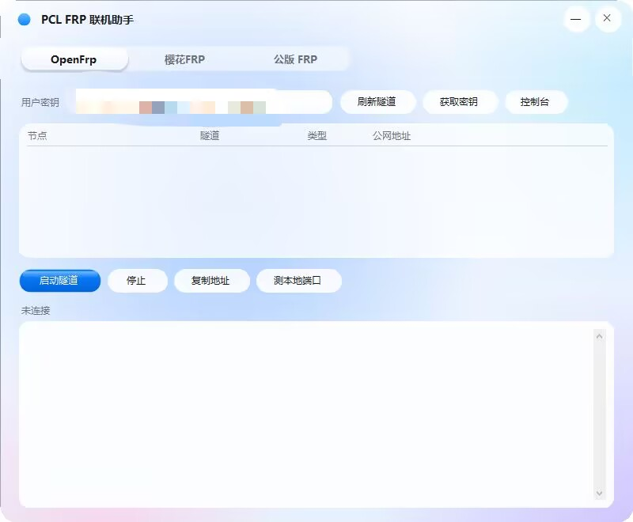

# PclFrpHelper

PCL 2.12 联机页的 **FRP 联机入口** 与 **FRP 助手**（OpenFrp / 樱花FRP / 公版 FRP）。

界面为自绘的 Liquid Glass 风格，单文件分发：插件与助手都内嵌进 PCL 的 exe，运行时自动释放。

> ⚠️ PCL（Plain Craft Launcher）是闭源软件。本仓库只包含我们自己写的插件与工具，
> 通过运行时注入的方式给 PCL 增加一个入口，**不包含也不分发 PCL 本体**。

---

## 功能

| 平台 | 能力 |
| --- | --- |
| **OpenFrp** | 用户密钥 → 隧道列表 → 一键启动官方 frpc → 显示/复制公网地址 |
| **樱花FRP** | 访问密钥 → 账号信息 + 隧道列表 → 选中隧道自动填 ID → 启动官方 frpc |
| **公版 FRP** | 自建 frps 地址/端口/token/本地端口/远程端口 → 生成配置并启动 fatedier frpc |
| 通用 | 本地端口检测、日志清理（ANSI）、配置持久化、密钥快捷跳转 |




## 目录结构

```
pcl-frp/
├── src/
│   ├── PclFrpHelper/          # WinForms 助手（Liquid Glass 自绘控件）
│   │   ├── Program.cs         # 入口 + Tunnel 模型
│   │   ├── GlassControls.cs   # 主题、按钮、输入框、标签栏、列表
│   │   ├── MainForm.cs        # 窗口、三个页签、业务逻辑
│   │   └── PclFrpHelper.csproj
│   └── PclFrpAddon/           # WPF 插件（往 PCL 联机页塞按钮）
│       ├── Ui.cs
│       └── PclFrpAddon.csproj
├── tools/
│   └── patch-pcl.ps1          # 用 Mono.Cecil 给 PCL exe 打补丁
├── docs/                      # 截图
├── build.ps1                  # 一键构建
└── .github/workflows/build.yml
```

## 构建

### 依赖

- .NET Framework 4.6.2（Windows 自带 4.x 运行时即可运行）
- 编译：`.NET Framework 自带的 csc.exe`，或 Visual Studio / MSBuild / `dotnet build`
- 打补丁：`Mono.Cecil`（NuGet: `Mono.Cecil`，仅 `patch-pcl.ps1` 需要）

### 一键构建

```powershell
# 只用系统自带的 csc 编译助手 + 插件
./build.ps1

# 顺便把插件注入到一个原始 PCL exe，生成单文件版
./build.ps1 -PclExe "C:\path\to\Plain Craft Launcher 2.exe" -CecilPath "C:\path\to\Mono.Cecil.dll"
```

产物在 `dist/`：

```
dist/
├── PCL/frp/PclFrpHelper.exe     # 助手
├── PCL/frp/PclFrpAddon.dll      # 插件
└── Plain Craft Launcher 2.exe   # 仅当传了 -PclExe
```

### 用 Visual Studio / dotnet

```powershell
dotnet build src/PclFrpHelper/PclFrpHelper.csproj -c Release
dotnet build src/PclFrpAddon/PclFrpAddon.csproj -c Release
```

> 插件项目会把 `build/PclFrpHelper.exe` 作为嵌入资源打包；先构建助手再构建插件。

## 工作原理

1. **插件**（`PclFrpAddon.dll`）用 WPF 在联机页右下角/左下角画一个玻璃按钮，
   点击时把内嵌的 `PclFrpHelper.exe` 释放到 `PCL\frp\` 并启动。
2. **注入**：`tools/patch-pcl.ps1` 用 Mono.Cecil 给 PCL 的 `PageLinkMain` 加一个
   `FrpAttachAddon()` 方法，从自身嵌入资源读出插件字节、`Assembly.Load(bytes)`、
   反射调用 `Attach(PanSelect)`；同时在构造函数里调用它。
3. 补丁还会把「联机」页签和被隐藏的设置项显示出来，并绕过服务端的
   `DisableReason2` 开关（PCL 2.12 曾临时关闭联机功能）。

## 使用

1. 运行构建出的 PCL（或把 `dist/PCL` 目录放到 PCL 旁边）；
2. 联机页点「FRP 联机」；
3. 选平台 → 填密钥 → 选隧道 → 启动；
4. 游戏里「对局域网开放」25565，把助手显示的公网地址发给朋友。

各家 frpc 会在首次启动时自动下载到 `PCL\frp\bin\<平台>\`。

## 配置

密钥存在 `%APPDATA%\PCL-FRP\config.ini`（明文）。请勿把该文件提交到仓库或分享给他人。

## License

MIT，详见 [LICENSE](LICENSE)。
